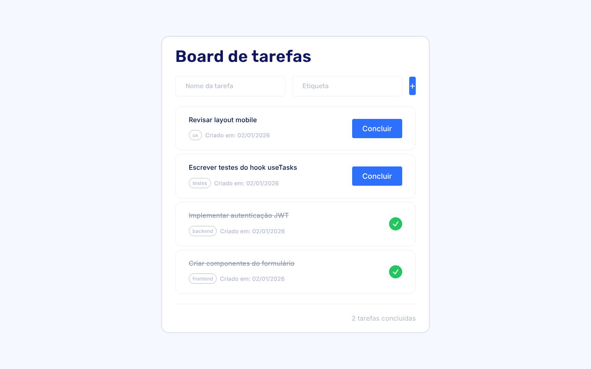
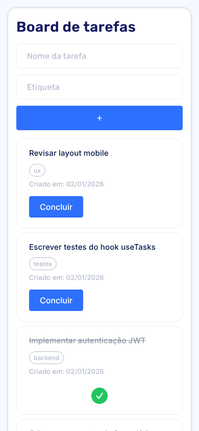

# Board de Tarefas

  

Gerenciador de tarefas em **React + TypeScript**, com hook customizado (`useTasks`), tipagem forte e persistência no `localStorage`. Layout responsivo a partir de um protótipo no [Figma](https://www.figma.com/design/xryNIAyzDACBmbpmH4orjF/Desafio---Board-de-Tarefas-DNC).

Desafio de JavaScript da formação **Engenheiro de Software (Escola DNC)**, entregue e aprovado na avaliação do projeto.

<p align="center">
  
  &nbsp;
  
</p>

## Como está organizado

- **Toda a regra mora no hook `useTasks`.** Adicionar, concluir, remover, contar concluídas e persistir. Os componentes só desenham e chamam funções, então dá para trocar a tela inteira sem mexer na lógica.
- **Persistência que sobrevive ao F5.** O estado inicial vem do `localStorage` (inicialização preguiçosa do `useState`), e um `useEffect` salva a cada mudança. Como JSON não guarda `Date`, as datas são reconvertidas ao carregar.
- **Atualizações imutáveis.** Todas as mudanças usam `map` e `filter` sobre o estado anterior (`setTasks(prev => ...)`), nunca `push` direto no array.
- **Tipagem de ponta a ponta.** A interface `Task` é a mesma no hook, nos componentes e nas props, e o TypeScript acusa qualquer campo esquecido.
- Tarefas pendentes aparecem primeiro, e o formulário ignora entradas vazias ou só com espaços.

## O que aprendi

- Criar hooks customizados para separar estado e regra da interface
- Tipar props, estado e funções em React com TypeScript
- Persistir estado no navegador e lidar com o que o JSON perde no caminho (datas)
- Por que o estado em React é imutável e como isso afeta a re-renderização

## Rodando

```bash
git clone https://github.com/lucas-gonzales-dev/task-board-react-ts.git
cd task-board-react-ts
npm install
npm run dev     # http://localhost:5173
```

## Estrutura

```
src/
├── hooks/useTasks.ts        estado, regras e persistência
├── components/TaskForm.tsx  formulário de nova tarefa
├── components/TaskCard.tsx  card de tarefa
├── types/Task.ts            tipo compartilhado
└── App.tsx                  ordena e monta a tela
```

---

Feito por **Lucas Leite Gonzales** · [LinkedIn](https://www.linkedin.com/in/lucas-leite-gonzales-dev/)
